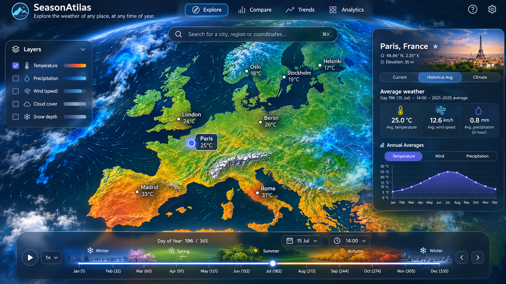

# SeasonAtlas

An interactive globe of Earth, evolving into the SeasonAtlas weather explorer.
Explore physical geography, coastlines, rivers, lakes, country borders and terrain.
Search for a city, select a map location and choose a seasonal day and hour.
The existing Globebase geography forms the foundation, with historical weather
averages for selected locations. The local three-hour temperature overlay pipeline is documented in
[local weather setup](docs/local-weather.md); real tiles require a completed CDS download.

## SeasonAtlas design reference

The intended direction is SeasonAtlas: explore the weather of any place, at any
time of year. The reference shows weather layers on an interactive globe,
location search, a location weather panel, annual averages and a seasonal timeline.
This is a design target for future development.



## SeasonAtlas development plan

This plan describes future work toward the design reference above. The sections
from **Getting started** onward document the current Globebase application.
Effort estimates are provisional and assume the existing map code can be reused.
The technologies below are proposed choices, not a list of installed dependencies.

### 1. Target experience

Allow someone to select any location in Europe, choose a day and hour, and see
what the weather is typically like at that point in the year.

User journey: **Explore map → Select time → Choose layer → Inspect city**.

The five core capabilities are:

1. Smooth zoomable terrain map, down to city scale.
2. Temperature, precipitation, wind and cloud visualizations.
3. Interactive day-of-year and hour-of-day timeline.
4. Clickable locations with historical averages and graphs.
5. Smooth animation between times, days and seasons.

### 2. Implementation phases

#### Phase 1 — Map foundation

**Start here. Estimated effort: 2–4 development days.**

Preserve the existing terrain tiles, hillshade and dark ocean. Introduce
controlled zoom, smooth transitions, city labels and location selection. Add a
floating search bar and map navigation controls.

**Deliverable:** a polished geographical explorer without weather overlays.

#### Phase 2 — Seasonal timeline

**Estimated effort: 2–3 development days.**

Build a translucent bottom timeline with January–December, day selection, a
separate 00:00–23:00 hour control, playback, speed adjustment and smooth dragging.
Connect everything to a single shared date/time state.

**Deliverable:** the map and location panels respond consistently to a selected
date and hour.

#### Phase 3 — Historical weather engine

**Estimated effort: 3–6 development days.**

Integrate historical weather data, compute hourly seasonal averages, cache
results, and retrieve statistics using latitude and longitude. Handle leap days,
time zones, missing data and geographic resolution.

**Deliverable:** real average temperature, precipitation and wind statistics for
any selected city or map location.

#### Phase 4 — Weather overlays

**Estimated effort: 5–10 development days.**

Render temperature as a continuous gradient over terrain. Add precipitation
shading and wind-speed layers. Introduce legends, opacity controls and
transitions between layers and time slices.

**Deliverable:** the entire map changes with the selected season instead of
showing weather only inside city panels.

#### Phase 5 — City analytics

**Estimated effort: 3–5 development days.**

Add a floating glass panel displaying city, coordinates, temperature, wind speed,
precipitation and a 12-month chart. Include annual extremes, date-specific
statistics, units and data provenance.

**Deliverable:** clicking Paris, London or any map coordinate opens a weather
analysis panel.

#### Phase 6 — Immersive effects and polish

**Estimated effort: 5–10 development days.**

Add animated wind particles, gentle cloud transitions, glassmorphism, dynamic
lighting, responsive layouts and a cinematic loading experience. Optimize
animation and graceful performance fallbacks.

**Deliverable:** the premium, atmospheric experience represented by the mockup.

**Estimated total: approximately 20–38 development days for one developer.**
The biggest unknown is the weather-overlay pipeline, not the interface styling.
The individual phase ranges sum to 20–38 days.

### 3. Recommended technical architecture

Retain the existing MapLibre renderer, terrain relief and tile sources where
possible. Confirm their capabilities before extending the map.

| Component | Proposed technology | Purpose |
| --- | --- | --- |
| Frontend | React + TypeScript | Application UI and shared state |
| Map renderer | MapLibre GL JS | Terrain, zoom, layers and map interaction |
| Styling | Tailwind CSS | Floating glass panels and responsive design |
| Animation | Motion + WebGL shaders | UI and visual transitions |
| Weather data | ERA5 / ERA5-Land | Historical weather averages |
| City weather lookup | Open-Meteo | Point-based weather statistics |
| Weather overlay | Raster tiles / GPU shaders | Colour temperature, precipitation and wind across the map |
| Charts | Recharts | Monthly and seasonal weather graphs |
| Processing | Python + xarray | Preparing and aggregating historical data |

The plan uses MapLibre for raster elevation, hillshade and terrain rendering,
and proposes Open-Meteo for hourly historical temperature, precipitation, wind
speed and cloud cover, including ERA5-based data. Validate provider coverage,
access requirements and dataset suitability during the weather-engine phase.

### 4. Seasonal weather data

Precompute a climatological weather atlas instead of downloading historical
records every time a user drags the timeline.

1. **ERA5 historical dataset:** temperature, wind and precipitation across
   multiple years.
2. **Python processing pipeline:** group by calendar day and hour; calculate
   averages.
3. **Optimized weather grids and tiles:** cache by variable, day, hour and
   geographic area.
4. **SeasonAtlas interactive map:** fast timeline updates and location statistics.

For the first version, consider a **1991–2020 climate-normal baseline** or a more
recent 10–20-year period. A five-year period works for a prototype, but averages
for individual days can be noisy, especially for precipitation.

Start with daily map overlays and hourly city statistics. Add hourly map-wide
overlays once the pipeline is proven. Show a **model resolution** indicator when
users zoom into cities: zooming increases visual detail, not the underlying ERA5
grid resolution.

### 5. UI layout specification

Keep the terrain visible behind every control. Sidebars should be collapsible,
and the timeline should overlay the map rather than permanently reducing its
height. This structural wireframe supports the full-screen cinematic mockup.

| Area | Contents |
| --- | --- |
| Header | SeasonAtlas; Explore; Compare |
| Floating search | Search city or coordinates… |
| Layers panel | Temperature; Wind; Rainfall |
| Map canvas | Interactive terrain and weather overlay |
| Location panel | Paris, France; 25°C; Wind 12.6 km/h; Rainfall 0.8 mm/h |
| Time controls | 15 July · 14:00 |
| Bottom timeline | January–December with spring, summer and autumn markers |

The Paris values above are illustrative metrics, not measured weather data.

### 6. Suggested first development sprint

**Sprint 1 — Functional foundation**

**9/9 complete.** The functional foundation now includes location search, time
selection and validated historical point-weather averages.

- [x] Identify the existing map renderer and tile sources.
- [x] Extract map view state (centre, zoom, pitch and bearing).
- [x] Build the SeasonAtlas header and floating search.
- [x] Add day-of-year and hour sliders.
- [x] Create a shared time and selected-location state.
- [x] Connect location clicks to Open-Meteo historical weather.
- [x] Display temperature, wind and precipitation in a floating panel.
- [x] Add loading, empty and error states.
- [x] Validate selected weather averages against source data.

### 7. Priorities and milestones

1. **Usable MVP:** the original map plus timeline, city search, weather data, a
   location panel and a basic temperature overlay. This proves the core
   interaction.
2. **Immersive map:** continuous weather colour gradients, animated wind vectors,
   smooth seasonal transitions and high-performance tiled data.
3. **Polished product:** city comparisons, advanced historical analytics,
   responsive design, accessibility and cinematic visual details.

Build incrementally: first make the original map respond to time and location,
then make the weather visible across the terrain, and finally add atmospheric
effects. Each milestone should move toward a working SeasonAtlas experience.

## Getting started

Use Node.js 20.9+ and the pnpm version pinned in `package.json`.

```sh
pnpm install
pnpm dev             # http://localhost:3000
```

Drag to explore, scroll to zoom, and use the navigation control to adjust the
camera. Open **Globe settings** to adjust terrain exaggeration and hillshade.
The initial camera looks toward the equator at the prime meridian.

Use the floating search to find cities or enter **latitude, longitude** (for
example, `48.8566, 2.3522`). Search supports arrow keys, Enter to select and Escape
to dismiss. Suggested cities are available before typing; other city searches
use Open-Meteo geocoding and require a network connection. Click or tap the map
to select any coordinate. A marker and floating panel show the selected location;
on phones the panel sits at the bottom. Close the panel to clear the selection.
City results include elevation and time zone when supplied by the geocoder.

The bottom seasonal timeline selects a day in a yearless **365-day calendar**
(no leap day) and a separate **UTC hour, every three hours from 00:00–21:00**. Drag either slider, use
its arrow keys, jump to a month, or step one day backward or forward. The location
panel reflects the same selected time. Play advances two days per second at 1×;
2× and 4× increase that rate while retaining the selected hour. Playback wraps
from 31 December to 1 January, pauses when the tab is hidden, and stops when you
manually select a day or hour. Season labels use Europe's meteorological seasons.
The location panel shows historical average temperature, 10 m wind speed and
preceding-hour precipitation for the selected time. **2020–2024** is the averaging
period, using the **same UTC hour across the selected date ±7 days**. These are
historical model averages, not a current forecast. Expand **About these averages**
for model resolution, grid coordinates, time zone and the averaging method.

A new location/month loads historical records once; changing the hour or day
within that month uses the downloaded averages. Playback pauses when an uncached
month needs data. First lookups may take up to 90 seconds; loading, missing-data
coverage and retry states appear in the panel. Mobile panels scroll to reveal
additional details. A separate three-hour temperature overlay can be generated and
served locally; see [local weather setup](docs/local-weather.md). The annual temperature chart shows monthly means at the selected UTC hour, with
a marker for the selected day. Click the chart to move the timeline, use arrow
keys for one-day steps (Shift for a week), or Home/End for year boundaries. Its
monthly values and method are available below the chart. It uses the bundled
0.5° map averages, so it can differ from the point panel’s native 0.25° values.
Additional weather overlays remain future work.

Use the **2D / 3D** control at the upper right to switch between a Mercator map
and the globe. The current location, zoom and layers stay in place; switching
to 2D also resets tilt and bearing for a north-up map.

**Urban areas** are enabled by default in Globe settings. Muted warm-grey
settlement footprints fade in between zooms 2 and 5, above land fills and below
coastlines, rivers and lakes. These are generalised urban extents, without
individual buildings or city labels.

**Country borders** are always visible in both 2D and 3D. Muted grey-green lines
scale with zoom above terrain and water. The bundled Natural Earth 1:50m
boundaries are generalised and reflect the pinned dataset rather than live updates.

The base globe needs no account, backend or API key.
Mapterhorn elevation tiles load over the network; unavailable elevation does
not prevent navigation or the local physical geography from rendering.

## Bundled three-hour temperature overlay

Use `pnpm weather:trial` for a real one-day sample, then `pnpm weather:arco` for
worldwide generation. The isolated Python environment is described in
[the local workflow](docs/local-weather.md). No account or API key is needed:
temperature chunks come directly from [Google Research’s public ARCO-ERA5 mirror](https://github.com/google-research/arco-era5).

The world build uses **2020–2024**, the selected date **±7 days at the same UTC
hour**, a **0.5° area-weighted grid**, and eight frames per day (00, 03, 06, 09,
12, 15, 18 and 21 UTC). The map and location panel share the UTC clock. The panel
retains its 0.25° point grid, so its value can differ from the spatially averaged overlay.
Tiles are 128-pixel PNGs through zoom 3; further zooming adds no weather detail.

**Temperature** is enabled on startup. Open **Globe settings** for opacity,
legend, the displayed frame and data provenance. Day and hour changes crossfade
between complete frames while loading; failures retain the last frame and expose
Retry. The existing daily Europe atlas remains active until the complete world
atlas is validated and installed. Reload the app after installation.

A July trial produced **680 tiles / 7.73 MB**, projecting to **2.82 GB** for a year
of three-hour frames. Eight source grids were 18.57 MB; the five-year source
transfer projects to roughly **34 GB**, separate from the shipped atlas. These
are single-day estimates, not final totals. Progress is in
`.weather-data/arco/status.json`; downloads and rendering can resume with the same command.
Only the generated tiles and attribution ship under `public/weather/`.

## Architecture

- `app/`: page shell, metadata, fonts and global styling.
- `components/`: client-only globe lifecycle, navigation hints, globe settings,
  rendering diagnostics and loading/error states.
- `map/`: MapLibre style, coastline detail, physical terrain, hillshade and
  temperature overlays.
- `state/explorationStore.ts`: serializable camera and selected-location state.
- `lib/locations.ts`: city geocoding, suggested cities and coordinate parsing.
- `lib/seasonalTime.ts`: yearless calendar, season labels and time formatting.
- `lib/weather/`: validated ERA5 records, DST-aware averaging and bounded caches.
- `app/api/weather/`: historical monthly weather endpoint.
- `public/geo/`: locally hosted Natural Earth geography and vector tiles.
- `scripts/`: reproducible geography preparation, weather generation and checks.

MapLibre owns the globe and WebGL lifecycle. Its worker is emitted as a bundled
asset through a static `new URL(...)` reference. Runtime renderer objects stay
outside shared application state. Camera changes are mirrored into the store
on `moveend`; camera snapshots do not drive the camera back. Explicit city or
coordinate selections trigger a separate flight to the selected location.

## Data and attribution

Historical weather comes from [Open-Meteo's archive API](https://open-meteo.com/en/docs/historical-weather-api),
pinned to **ERA5**, with [Copernicus ERA5](https://cds.climate.copernicus.eu/datasets/reanalysis-era5-single-levels)
attribution. Derived averages retain [CC BY 4.0](https://creativecommons.org/licenses/by/4.0/)
credit. ERA5's native grid is 0.25° (approximately 25 km); map zoom adds no weather
detail. The nearest grid cell is requested with elevation downscaling disabled.
Temperature is in °C, wind in km/h, and precipitation in mm over the preceding
hour (including dry hours, not rain probability).

Weather timestamps are requested as Unix seconds and converted using the returned
IANA time zone's historical rules. Repeated daylight-saving hours are averaged
within each year before averaging across year-day samples; skipped hours and
null values are excluded, with coverage shown when incomplete. February 29 is
omitted. January/December smoothing wraps within the same five baseline years.
The baseline, model and window are configured in `lib/weather/climate.ts`.

Weather needs the running Next.js server and network access. Raw date ranges use
Next.js fetch caching for 30 days; derived months use a bounded 48-entry process
cache for seven days and a 24-entry browser-session cache. HTTP results cache for
one day in the browser and seven days in shared caches. Identical in-flight
lookups are shared, no more than two different months build concurrently, and
upstream request starts are paced. Errors are not cached. Process/session caches
reset on restart; hosting platforms may impose shorter execution limits than the
120-second route budget. A shared persistent atlas/job service is needed before
scaling this point-lookup prototype to large public traffic or map overlays.

The default Open-Meteo endpoint is for non-commercial prototyping and has
[usage limits](https://open-meteo.com/en/pricing). Commercial deployment requires
an appropriate provider plan and endpoint configuration.

City search uses [Open-Meteo geocoding](https://open-meteo.com/en/docs/geocoding-api)
with location data from [GeoNames](https://www.geonames.org/). Entered coordinates
and map clicks do not need the geocoding service.

Natural Earth v5.1.2 provides local 50m global land, lakes and rivers, with 10m
regional coastlines loaded as vector tiles. Natural Earth is public domain;
Globebase retains voluntary attribution. See the [vendored data notes](public/geo/natural-earth-v5.1.2/README.md)
for provenance and reproducible preparation.

Natural Earth urban areas (dataset v4.0.0, vendored from the pinned v5.1.2
repository) add 11,878 settlement footprints as 341 local vector tiles at
zooms 0–4, totalling approximately 3.9 MB. Only visible tiles are requested;
closer zooms reuse z4. The source describes these outlines as derived from
2002–2003 MODIS imagery at 1 km resolution: they do not represent current
urban growth or precise building boundaries. See the
[dataset description](https://www.naturalearthdata.com/downloads/10m-cultural-vectors/10m-urban-area/).
Rebuild with `node scripts/prepare-urban-areas.mjs` (or pass a local original
GeoJSON path). The script verifies the upstream SHA-256 and uses existing
MapLibre tiling dependencies; it adds no packages. Provenance and checksum
are in the vendored data notes.

Mapterhorn supplies remote Terrarium elevation tiles through native zoom 12,
with attribution retained in the map. Terrain defaults to 1× elevation.
The geography is a static physical baseline.

## Validation

```sh
pnpm typecheck
pnpm lint
pnpm build
node scripts/check-geography.mjs
node scripts/check-hillshade.mjs
node scripts/check-weather.mjs
```

## Limits

Natural Earth coastlines and water are generalized, even at regional zoom.
They may not match the elevation surface exactly. Elevation services need
network access. WebGL 2 is required; an explanatory fallback is
shown when unavailable. Rendering diagnostics are shown on wider screens.

The documents in `docs/` retain earlier terrain implementation
records, including observations of interface features that have since been
removed. The current-application sections of this README describe the existing application;
the SeasonAtlas development plan describes intended future work.
